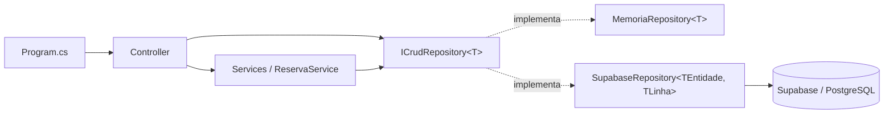
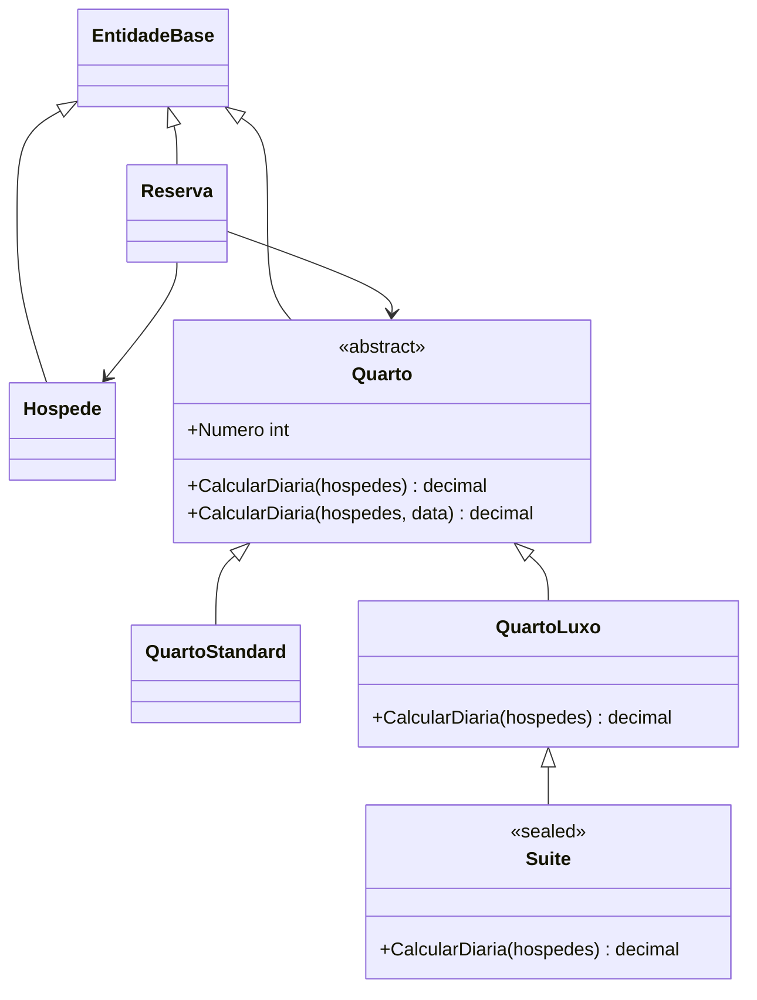

# HotelCSharp

Sistema de hotelaria em **C# / .NET 10** para praticar **Programação Orientada a Objetos** e **arquitetura em camadas**: superclasses, sobrescrita, sobrecarga, polimorfismo, interfaces, repositório genérico e banco de dados real no **Supabase (PostgreSQL)**.

Projeto de prática do curso **Curso de POO Completo com C#** (Udemy) · [certificado de conclusão](http://ude.my/UC-2bc80901-9a27-4a1a-808e-d448e2f2e8e3)

## O que o sistema faz

- Cadastra hóspedes (CPF único) e quartos (número único).
- Três tipos de quarto, cada um com a sua regra de preço.
- Reserva com verificação de disponibilidade, check-in, check-out e cancelamento.
- Relatório: reservas por status, faturamento realizado e previsto, tipo de quarto mais reservado.
- Guarda os dados em memória ou no Supabase, sem mudar o resto do código.

| Quarto | Capacidade | Diária | Regra própria |
| --- | --- | --- | --- |
| Standard | 2 | R$ 180 | Usa a regra da superclasse |
| Luxo | 3 | R$ 320 | + R$ 60 por pessoa acima de duas |
| Suíte | 4 | R$ 550 | Regra do Luxo + 10% de serviço |

Noites de sexta e sábado custam 15% a mais em qualquer quarto.

## Conceitos de POO e onde estão

| Conceito | Onde |
| --- | --- |
| Superclasse abstrata | [`Quarto`](src/HotelCSharp/Model/Quarto.cs), [`EntidadeBase`](src/HotelCSharp/Model/EntidadeBase.cs), [`HotelException`](src/HotelCSharp/Exceptions/HotelException.cs) |
| Herança em 3 níveis | `Quarto` → [`QuartoLuxo`](src/HotelCSharp/Model/QuartoLuxo.cs) → [`Suite`](src/HotelCSharp/Model/Suite.cs) |
| Construtor chamando a superclasse | `public Suite(int numero, int andar) : base(numero, andar)` |
| Sobrescrita com `base` | `QuartoLuxo.CalcularDiaria` soma a pessoa extra à regra do pai; `Suite` aplica a taxa sobre a regra do Luxo |
| Membros `abstract` | `Tipo`, `CapacidadeMaxima` e `ValorDiariaBase` em `Quarto` |
| `sealed` | `Suite` e as exceções finais não podem ser herdadas |
| Sobrecarga | `CalcularDiaria(int)` e `CalcularDiaria(int, DateOnly)` em `Quarto` |
| Polimorfismo | `Reserva.ValorTotal` chama `Quarto.CalcularDiaria` sem saber o tipo do quarto |
| Encapsulamento | `Reserva.Status { get; private set; }`: só muda por `FazerCheckIn`, `FazerCheckOut` e `Cancelar` |
| Propriedades calculadas | `Reserva.Noites`, `Reserva.ValorTotal`, `Reserva.Ativa` |
| Sobrescrita de `object` | `ToString`, `Equals` e `GetHashCode` em [`Hospede`](src/HotelCSharp/Model/Hospede.cs) |
| Composição | `Reserva` tem um `Hospede` e um `Quarto` |
| Interface genérica | [`ICrudRepository<T>`](src/HotelCSharp/Repository/Interfaces/ICrudRepository.cs), [`ICrudController<T>`](src/HotelCSharp/Controller/Interfaces/ICrudController.cs) |
| Genéricos com restrição | [`MemoriaRepository<T> where T : EntidadeBase`](src/HotelCSharp/Repository/Memoria/MemoriaRepository.cs) |
| Template Method | [`SupabaseRepository<TEntidade, TLinha>`](src/HotelCSharp/Repository/Supabase/SupabaseRepository.cs): CRUD na superclasse, tabela e conversão nas filhas |
| Superclasse de controllers | [`CrudController<T>`](src/HotelCSharp/Controller/CrudController.cs) com métodos `virtual`; `HospedeController` e `QuartoController` sobrescrevem `AdicionarAsync` |
| Factory | [`QuartoFactory`](src/HotelCSharp/Model/QuartoFactory.cs) cria a subclasse certa a partir do tipo gravado no banco |
| Exceções próprias | `QuartoIndisponivelException`, `ReservaInvalidaException`, `CadastroDuplicadoException`, `RegistroNaoEncontradoException` |
| Injeção de dependência | Controllers e `ReservaService` recebem os repositórios pela interface no construtor |

## Arquitetura



- **Model**: entidades e regras de negócio. Não sabe que existe banco.
- **Controller**: porta de entrada (no curso, "simular uma API").
- **Services**: regras que envolvem várias entidades (disponibilidade, relatório).
- **Repository**: acesso a dados. Duas implementações da mesma interface: memória e Supabase.



## Como rodar

Precisa do [.NET SDK 10](https://dotnet.microsoft.com/download).

```bash
dotnet run --project src/HotelCSharp
dotnet test
```

No VS Code: abra a pasta e aperte **F5**.

Sem configuração, os dados ficam em memória. Para usar o Supabase:

1. Crie um projeto no [Supabase](https://supabase.com) e rode [`database/schema.sql`](database/schema.sql) no SQL Editor.
2. Copie `supabase.local.example.json` para `supabase.local.json` e preencha a URL e a chave *publishable* do projeto.
   Esse arquivo fica fora do Git. Também dá para usar as variáveis de ambiente `SUPABASE_URL` e `SUPABASE_KEY`.

O banco repete as regras principais com `check`, chave única e uma *exclusion constraint* que impede duas reservas ativas do mesmo quarto em datas que se cruzam.

> As políticas de acesso do `schema.sql` liberam leitura e escrita para a chave pública, porque é um projeto de estudo sem login. Num sistema real o acesso passaria por autenticação.

## Estrutura

```
src/HotelCSharp/
  Model/         EntidadeBase, Hospede, Quarto (+ Standard, Luxo, Suite), Reserva, QuartoFactory
  Enums/         ETipoQuarto, EStatusReserva
  Exceptions/    HotelException e filhas
  Controller/    ICrudController<T>, CrudController<T>, Hospede/Quarto/ReservaController
  Services/      ReservaService
  Repository/    ICrudRepository<T>, Memoria/, Supabase/
  Program.cs     simula o uso do sistema
tests/HotelCSharp.Tests/   36 testes (xUnit)
database/schema.sql        tabelas do PostgreSQL
```
